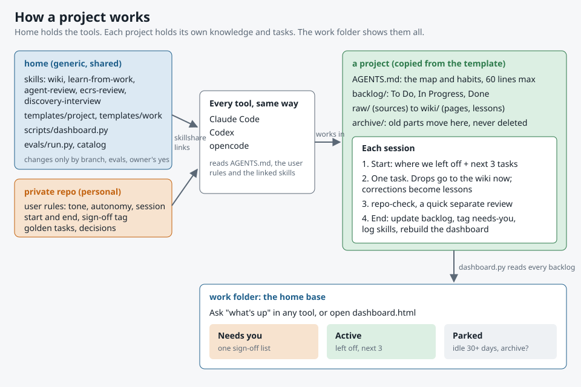

# How a project works



## In words

- **home** holds the tools: skills, the project template, the home base script and the eval runner. It changes only through a branch, the evals and the owner's yes.
- **The private repo** holds the owner's user rules (tone, autonomy, session start and end, the sign-off tag), the golden eval tasks and the decision record.
- **skillshare** links the skills and the user rules into every tool, so Claude Code, Codex and opencode behave the same. Details: [scopes](concepts/scopes.md#where-each-lives).
- **A project** is a copy of `templates/project/`: AGENTS.md (the map and habits), `backlog/`, `raw/` into `wiki/`, and `archive/`.
- **Each session** starts with where things left off and the next 3 tasks, does one task, and ends by updating the backlog, tagging what needs the owner, logging skill use and rebuilding the dashboard.
- **The work folder** is the front door. "What's up" in any tool, or `dashboard.html`, shows Needs you, Active and Parked across every project. More extras: [catalog](catalog.md#catalog).

## Where the tools look

Every tool checks a fixed folder in the user's home on every launch, whatever project is open. skillshare fills those folders with links, so one real copy in home serves every project, like `npm link`.

```
~/
├─ workspaces/home/skills/         the one real copy of each skill
├─ workspaces/<private repo>/user/AGENTS.md   the one real copy of the user rules
├─ .claude/skills/                 links to home's skills (Claude Code)
├─ .claude/CLAUDE.md               link to the user rules
├─ .agents/skills/                 links to home's skills (Codex, opencode, Gemini CLI)
├─ .codex/AGENTS.md                link to the user rules
└─ .config/opencode/AGENTS.md      link to the user rules
```

A project's own `.claude/skills` or `.agents/skills` adds skills for that project only. Every path per tool: [scopes](concepts/scopes.md#where-each-lives).
